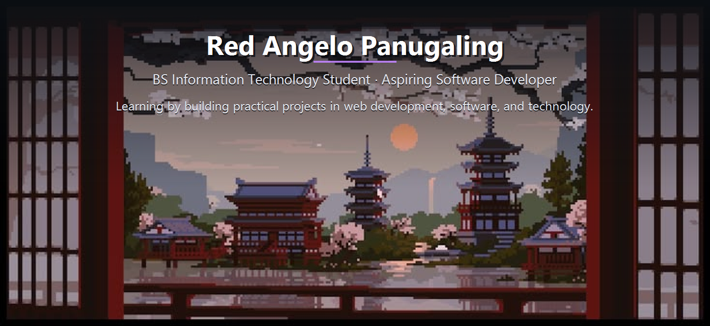

[About](#about-me) · [Tech Stack](#tech-stack) · [Projects](#featured-projects) · [GitHub Activity](#github-activity) · [Currently Learning](#currently-learning) · [Connect](#connect-with-me)

---

## About Me

I’m a **Bachelor of Science in Information Technology student at Davao del Sur State College**. I enjoy learning how software works by building small web projects, apps, and systems that solve practical problems.

I’m working toward becoming a professional software developer, growing my foundations in programming, web development, and databases with each project.

## Tech Stack

The technologies below are drawn from my existing profile and public repositories.

**Programming Languages**  

**Frontend Development**  

**Backend Development**  

**Database**  

**Tools and Platforms**  

## Featured Projects

| Selected project | Selected project |
|:---|:---|
| **[Dinasure](https://github.com/red-angelo-panugaling/dinasure)** An offline dinosaur runner game. JavaScript | **[AI Chatbot](https://github.com/red-angelo-panugaling/aichatbot)** A chatbot project from my repository collection. JavaScript |
| **[Motorcycle Display System](https://github.com/red-angelo-panugaling/motorcycle_display_system)** A motorcycle display system project. PHP | **[Portfolio](https://github.com/red-angelo-panugaling/portfolio)** My portfolio website. CSS |
| **[ML Project Compilation](https://github.com/red-angelo-panugaling/ml-project-compiltion)** A collection of machine-learning notebooks and projects. Jupyter Notebook | **[Browse all repositories →](https://github.com/red-angelo-panugaling?tab=repositories)** Explore more of my work on GitHub. |

## GitHub Activity

## Currently Learning

- Full-stack web development
- Database design and SQL
- Practical software and system development

## Connect With Me

---

*Keep learning. Keep building. See you in the next project.*

